# Jog The Robot

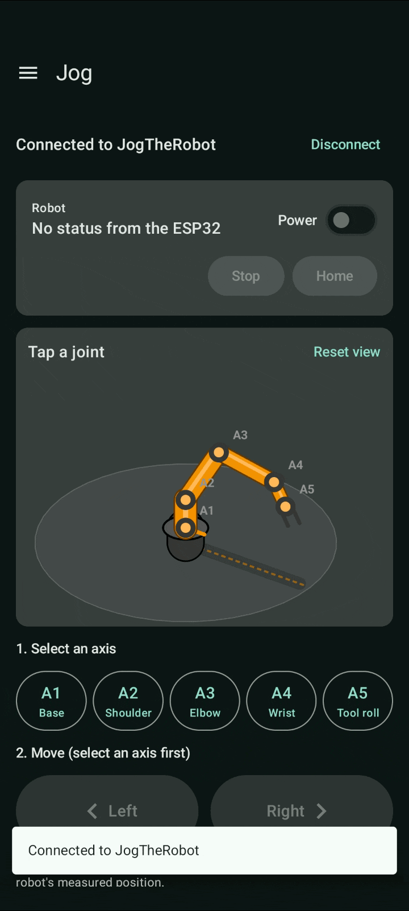

An Android app (Kotlin, Jetpack Compose) that jogs a 5-axis igus robolink-style robot arm from a phone, plus the ESP32 firmware (`JogReceiver`) that bridges the phone to the robot's PLC.

You can move the robot two ways:

- **Jog**: pick an axis, then hold Left or Right.
- **Gesture Jog**: stand in front of the phone's front camera. A YOLO26n-pose model running on the phone reads your body pose and turns it into jog commands.

```
 Android app ──BLE (Nordic UART)──► ESP32-S3-ETH ──Modbus TCP──► B&R X20CP0484 PLC ──► igus robot
              ◄── status lines ────               ◄── state + heartbeat echo ──
```

**Project site:** <https://nazmos-sakib.github.io/Jog-the-Robot/>

## Screens

| Home | Navigation drawer | Jog, PLC offline | Axis selected |
|---|---|---|---|
| 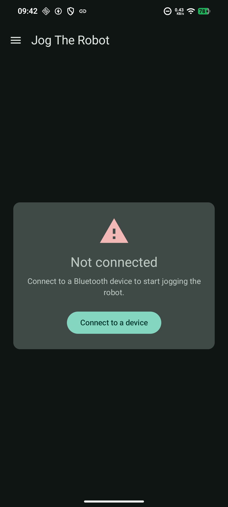 | 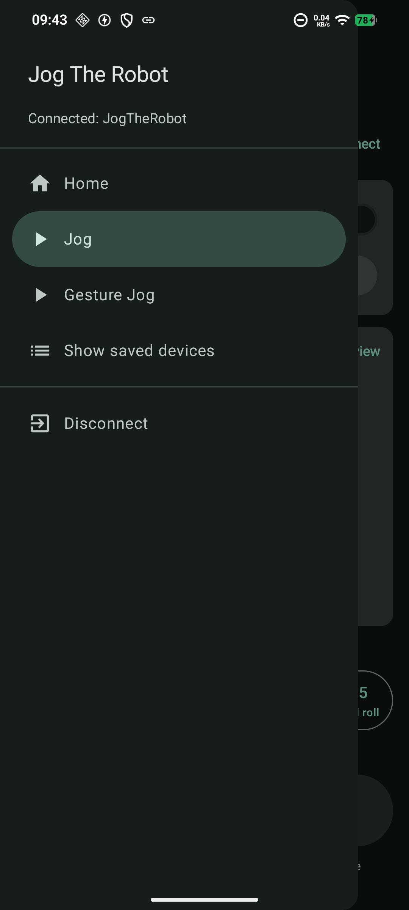 | 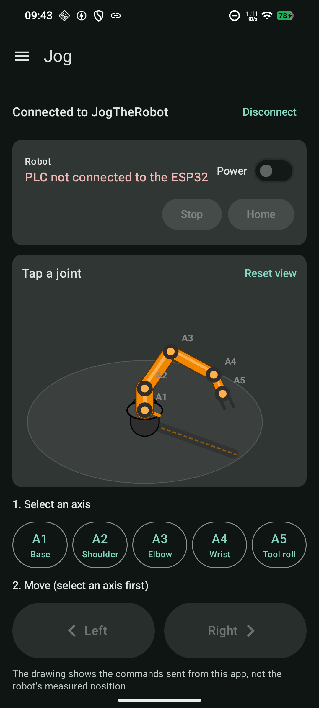 | 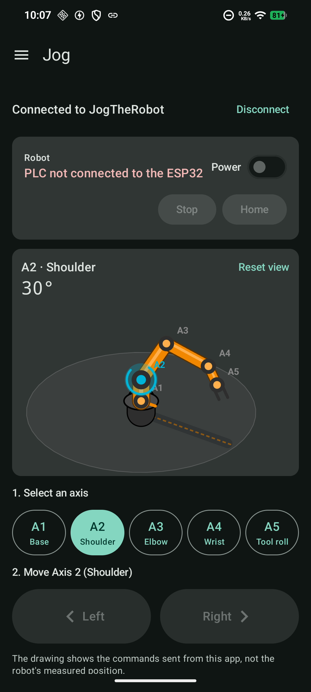 |
| Connection state and a shortcut to connect | Home, Jog, Gesture Jog, saved devices, Disconnect | Buttons stay disabled while the PLC is offline | Tap a joint to select it and see its angle |

| Homing | Ready | Jogging | Gesture Jog |
|---|---|---|---|
| 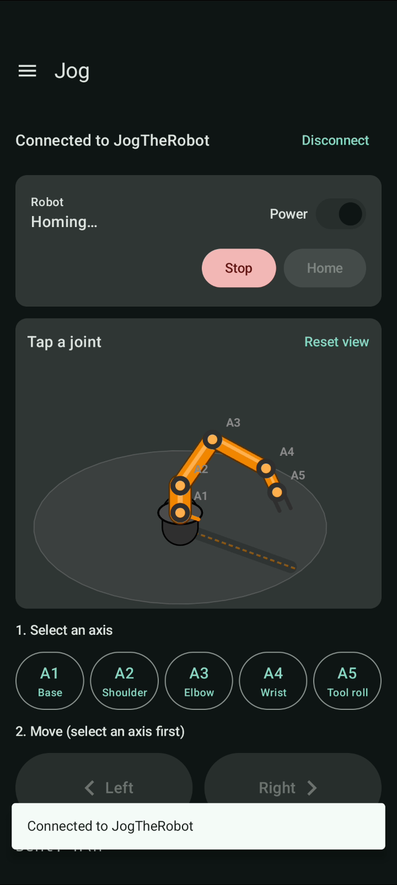 | 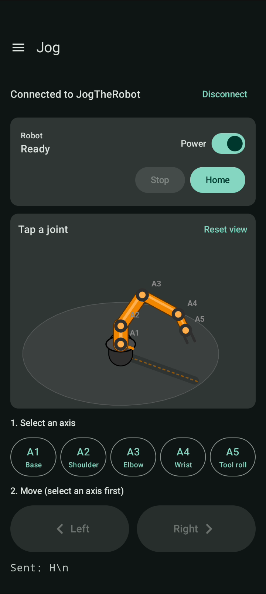 | 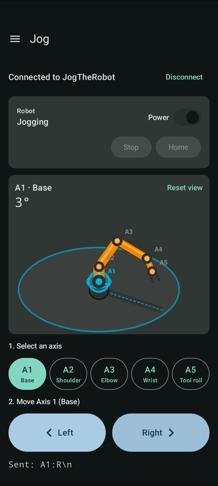 | 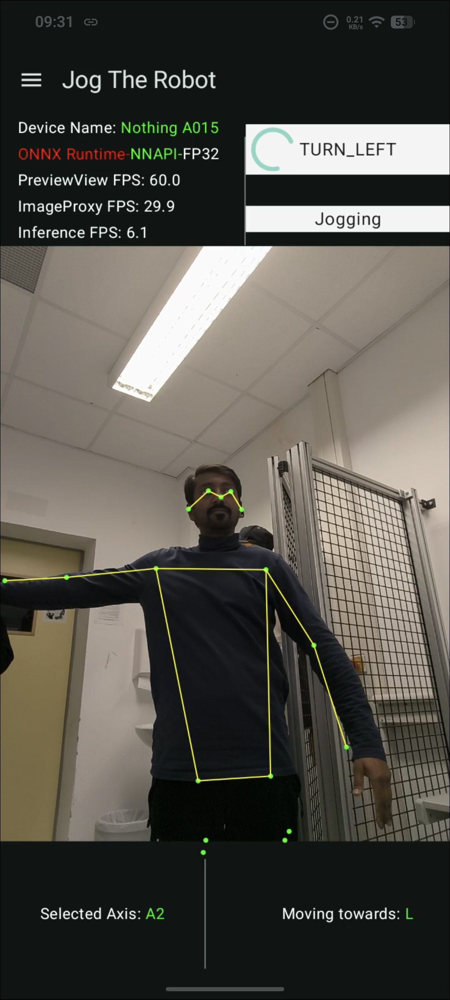 |
| After Power on, Home drives every axis to its reference | Powered and homed: jogging unlocks | Holding Right on A1 sends `A1:R` every 100 ms | Pose skeleton, detected command and FPS. More under [Gesture Jog](#gesture-jog) |

All screens are from a Nothing Phone (A015). Home, drawer, Jog and Axis selected were taken with the PLC offline; Homing, Ready and Jogging come from a live session with the robot.

## Video

<a href="docs/screenshots/jogScreen-side-by-side-video-demo.mp4">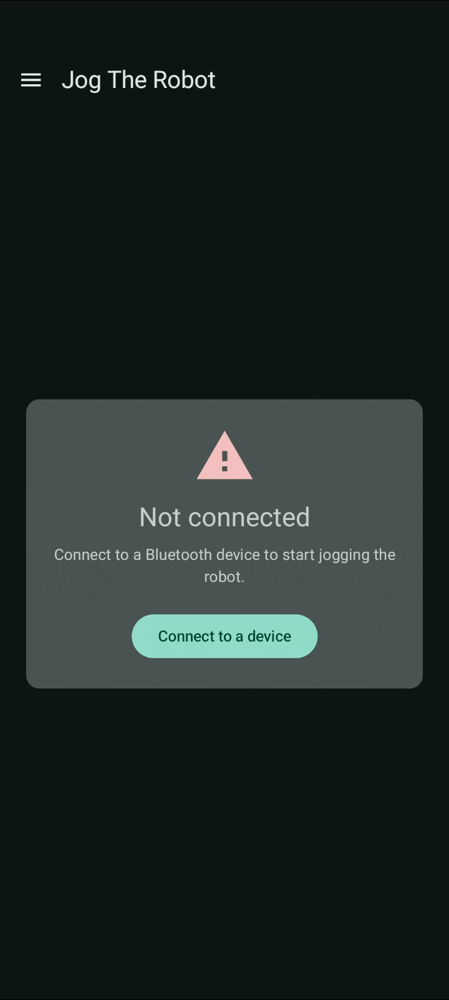</a>

- **[Jog, side by side (MP4, 23 s, 3 MB)](docs/screenshots/jogScreen-side-by-side-video-demo.mp4)**: the Jog screen and the igus arm next to each other, so you can see each tap on the phone move the real robot. The GIF above is a preview of the Jog screen.
- **[Gesture Jog, side by side (MP4, 1 min 43 s, 18 MB)](docs/screenshots/gesture-jog-demo-5.mp4)**: the Gesture Jog screen with pose detection next to the robot, from selecting an axis with a pose to jogging it with one arm out.

GitHub cannot play these inline in a README. Click a link to open the file, or watch them on the [project site](https://nazmos-sakib.github.io/Jog-the-Robot/#video).

---

## Contents

- [Screens](#screens)
- [Video](#video)
- [Repository layout](#repository-layout)
- [App architecture](#app-architecture)
- [Jog screen](#jog-screen)
- [Gesture Jog](#gesture-jog)
- [Hardware](#hardware)
- [Demos](#demos)
- [Bluetooth protocol](#bluetooth-protocol)
- [ESP32 ↔ PLC (Modbus TCP)](#esp32--plc-modbus-tcp)
- [Safety behaviour](#safety-behaviour)
- [Build and setup](#build-and-setup)

---

## Repository layout

| Path | What it is |
|---|---|
| `app/` | The Android app, package `dev.naz.jogtherobot` |
| `app/src/main/assets/yolo26n_pose_fp32.onnx`, `yolo26n_pose_int8.onnx` | Pose models used by Gesture Jog |
| `esp32/JogReceiver/JogReceiver.ino` | ESP32-S3-ETH firmware: BLE server + Modbus TCP server |
| `plc-for-usb/` | PLC-side Structured Text (`Main.st`, `RemoteJog.st`) and I/O mapping notes for the B&R project |
| `backup-*/` | Snapshots of earlier versions of a few files, kept for reference. Not part of the build. |
| `docs/` | GitHub Pages site (Jekyll): `index.html`, `_layouts/`, `assets/` |
| `docs/screenshots/` | Screenshots, photos, GIFs and videos used in this README and on the site |

## App architecture

The app is a single activity (`MainActivity`) hosting Compose navigation in `ui/JogTheRobotApp.kt`, with Hilt for dependency injection (`JogApp`, `module/AppModule.kt`). A navigation drawer links Home, Jog, Gesture Jog, Saved devices and Disconnect.

```
ui/
  JogTheRobotApp.kt        Nav graph, drawer, snackbar, ONNX inference presets
  screens/
    HomeScreen.kt          Connected / not-connected card
    SavedDevicesScreen.kt  Saved devices + BLE scan for nearby devices
    JogScreen.kt           Manual jog: status card, power/home/stop, axis + hold-to-jog
    RobotArmView.kt        Canvas drawing of the 5-axis arm (tap a joint to select it)
    GestureJogScreen.kt    Camera preview, skeleton overlay, gesture + robot status
    CameraPreview.kt       CameraX PreviewView + ImageAnalysis (RGBA_8888)
  viewmodel/CameraViewModel.kt   Frame → pose → gesture → jog loop
bluetooth/
  BluetoothController.kt   BLE scan, connect, MTU, notifications, chunked writes
  JogProtocol.kt           Axis / direction enums and the text command format
  RobotStatus.kt           PLC state machine enum and "ST:" line parser
data/
  datasource/ONNXModelDataSource.kt          ONNX Runtime session (CPU or NNAPI)
  repository/ONNXPoseDetectionRepository.kt  Letterbox, inference, post-processing
domain/
  usecase/GestureDetector.kt   Rules that turn 17 COCO keypoints into a RobotCommand
  model/…                      Pose, Keypoint, DetectedPose, InferenceConfiguration, …
utils/
  YOLOPostprocessor.kt, Enums.kt (runtime/delegate/precision), Constants.kt, FPS helpers
```

### BluetoothController

`BluetoothController` wraps Android BLE and exposes state as flows:

- `state`: `Disconnected`, `Connecting(device)` or `Connected(device)`.
- `incoming`: raw bytes from the ESP32's TX characteristic (notifications).
- Saved devices are kept in `SharedPreferences` (`saved_devices`). A device is saved after a successful connection and can be removed with the trash icon.
- Scanning runs for 15 s. Devices that advertise the Nordic UART service UUID are flagged as jog controllers.
- On connect it requests an MTU of 185, discovers services, enables notifications on TX (CCCD write), then reports `Connected`. Connect times out after 15 s.
- `send(text)` writes to the RX characteristic, split into MTU-sized chunks, with a 2 s timeout per write. It returns `false` if the write failed.

Required permissions: `BLUETOOTH_SCAN` and `BLUETOOTH_CONNECT` on Android 12+, or `BLUETOOTH`, `BLUETOOTH_ADMIN` and `ACCESS_FINE_LOCATION` on Android 11 and lower. `CAMERA` is needed for Gesture Jog.

### JogProtocol and RobotStatus

`JogProtocol` defines the five axes (`A1` Base, `A2` Shoulder, `A3` Elbow, `A4` Wrist, `A5` Tool roll), the two directions (`L`, `R`) and the fixed commands. See [Bluetooth protocol](#bluetooth-protocol).

`RobotStatus` parses `ST:<state>,<plcOnline>` lines. `RobotState` mirrors the PLC state machine:

| Code | State | Shown as |
|---|---|---|
| 0 | `DISABLED` | Power off |
| 5 | `POWER_ON` | Powering on… |
| 9 | `WAIT_FOR_HOME` | Powered, not homed |
| 10 | `HOMING` | Homing… |
| 20 | `IDLE` | Ready |
| 30 | `GCODE` | Running a program |
| 40 | `JOGGING` | Jogging |
| 50 | `MOVE_SET_POS` | Moving to a position |
| 99 | `ERROR` | Error |

Jogging is allowed only when the PLC is online and the state is `IDLE` or `JOGGING`. Home is allowed in `WAIT_FOR_HOME` and `IDLE`. Stop is enabled while a program, a move or homing is running. The power switch is locked while the robot is moving.

## Jog screen

`JogScreen` is reachable only while connected.

1. **Status card** shows the robot state from the ESP32 (or "PLC not connected to the ESP32"), a Power switch (`P1` / `P0`), and Stop (`X`) and Home (`H`) buttons. If no status line arrives for 3 s, the status is treated as unknown.
2. **Robot view** (`RobotArmView`) draws the arm on a Canvas. Tap a joint to select that axis. The selected joint is highlighted with its current angle. "Reset view" returns the drawing to the home pose (0°, 30°, 70°, 50°, 0°). The drawing shows what the app has sent, not the robot's measured position.
3. **Axis buttons** A1 to A5.
4. **Left / Right** hold-to-jog buttons. While held, the jog command is re-sent every 100 ms. On release, `S` is sent.

## Gesture Jog

`GestureJogScreen` opens the front camera with CameraX (4:3, RGBA_8888). Each analysed frame is rotated, letterboxed to 640×640 and run through YOLO26n-pose with ONNX Runtime. The first detected person's 17 keypoints go to `GestureDetector`, which returns a `RobotCommand`. The screen overlays the bounding box and skeleton and shows the current command, robot status, selected axis, direction, the device name, the active inference configuration and three FPS counters (PreviewView, ImageProxy, Inference).

### Gestures

| Pose | `RobotCommand` | Effect |
|---|---|---|
| Both arms hanging straight down | `NEUTRAL` | Arms the selector and clears the axis. An axis can only be chosen right after NEUTRAL. |
| Arms crossed above the head (X) | `STOP` | Select **A1** |
| T-pose, both arms horizontal | `START` | Select **A2** |
| Both hands up in a V/W above the head | `FORWARD` | Select **A3** |
| Both arms down at ~45°, hands apart | `BACKWARD` | Select **A4** |
| Left arm horizontal, right arm down | `TURN_LEFT` | Jog the selected axis **Left** |
| Right arm horizontal, left arm down | `TURN_RIGHT` | Jog the selected axis **Right** |
| No person in frame | `NO_PERSON` | Clear the axis and stop |

The sequence is: NEUTRAL, then an axis pose, then TURN_LEFT or TURN_RIGHT. A5 is not reachable by gesture yet.

| `TURN_LEFT` | `TURN_RIGHT` | `STOP` (arms crossed) |
|---|---|---|
|  | 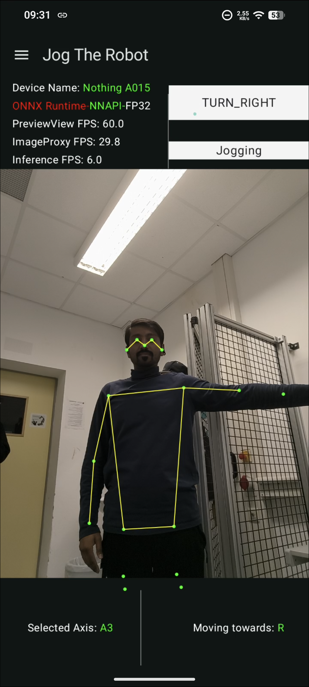 | 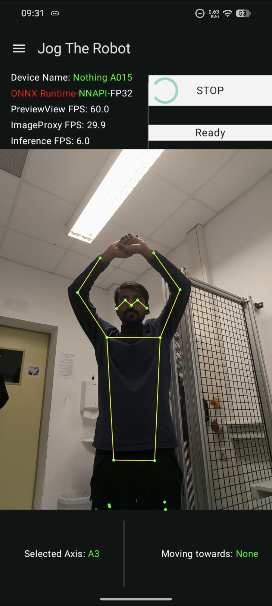 |
| Jogs the selected axis **Left** | Jogs the selected axis **Right** | Selects **A1** |

While the turn gesture keeps being detected, `CameraViewModel.startJog()` re-sends the jog command every 100 ms. Any other gesture cancels the jog job, and its `finally` block always sends `S`. If no frame shows the turn gesture for 400 ms (`GESTURE_TIMEOUT_MS`), the loop ends by itself, so the inference rate must stay above about 3 FPS.

### Inference configurations

`InferenceConfiguration` combines a runtime, a delegate and a precision. Gesture Jog uses ONNX Runtime with one of these presets from `ONNXConfuguration` in `JogTheRobotApp.kt`:

| Preset | Delegate | Precision | Model asset |
|---|---|---|---|
| `cnf1` | CPU | FP32 | `yolo26n_pose_fp32.onnx` |
| `cnf2` | CPU | INT8 | `yolo26n_pose_int8.onnx` |
| `cnf3` (current) | NNAPI | FP32 | `yolo26n_pose_fp32.onnx` |
| `cnf4` | NNAPI | INT8 | `yolo26n_pose_int8.onnx` |

- **CPU** sessions use `OptLevel.ALL_OPT`.
- **NNAPI** sessions are created with `NNAPIFlags.USE_FP16` and `NNAPIFlags.CPU_DISABLED`. Keep `CPU_DISABLED` on for NNAPI runs: it stops NNAPI from falling back to its own reference CPU implementation, so the measurement reflects the accelerator rather than a slow NNAPI-CPU path.

To switch preset, change the argument of `cameraViewModel.startCameraSession(...)` in the `GESTURE_JOG` route. On the A015 with `cnf3`, the screen shows about 6 inference FPS.

`RuntimeOption` in `utils/Enums.kt` also lists TFLite, NCNN and PyTorch Mobile with their supported delegates and precisions. Only the ONNX path is wired up in this build.

## Hardware

| B&R X20 PLC | X20CP0484 CPU | ESP32-S3-ETH bridge |
|---|---|---|
| 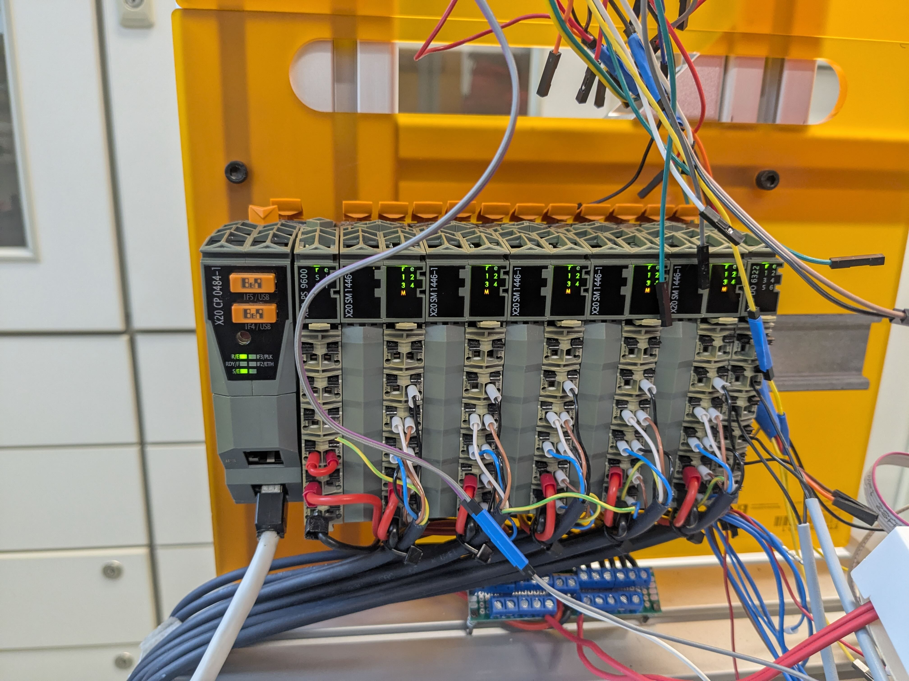 | 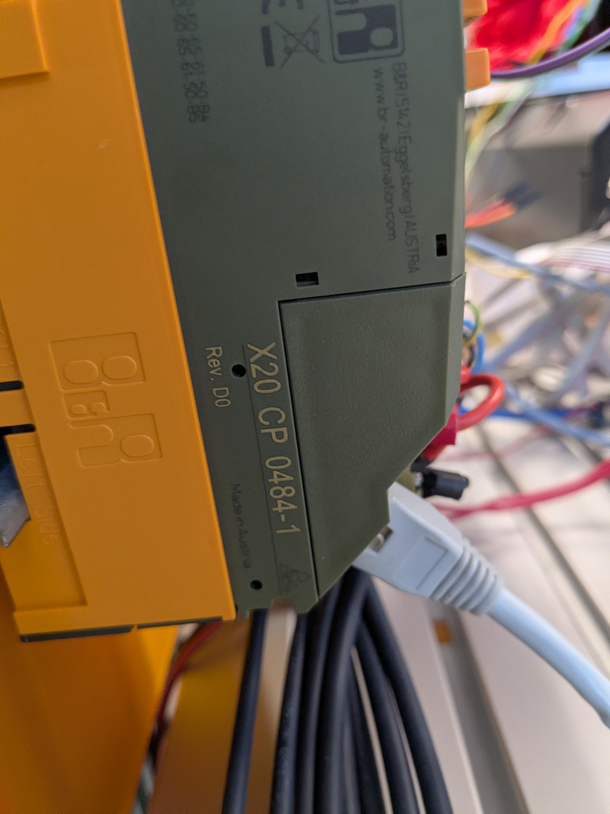 | 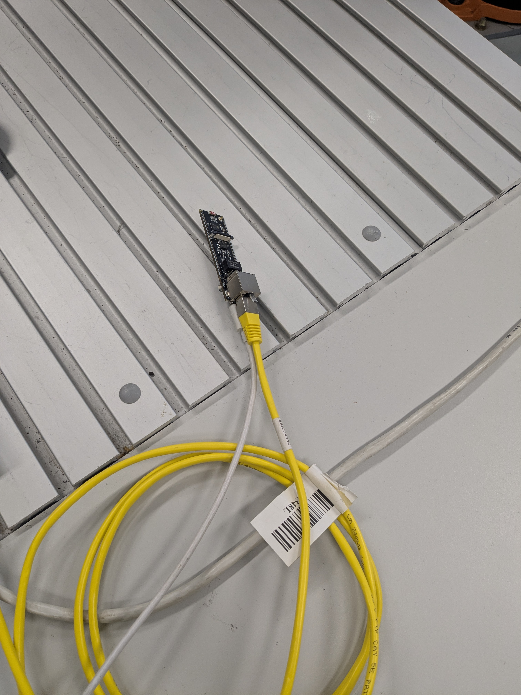 |
| The X20 rack with its I/O modules, wired into the robot cabinet | The CPU that runs the jog state machine and polls the ESP32 | The BLE-to-Modbus bridge on the PLC network |

The igus 5-axis arm from four angles:

| | | | |
|---|---|---|---|
| 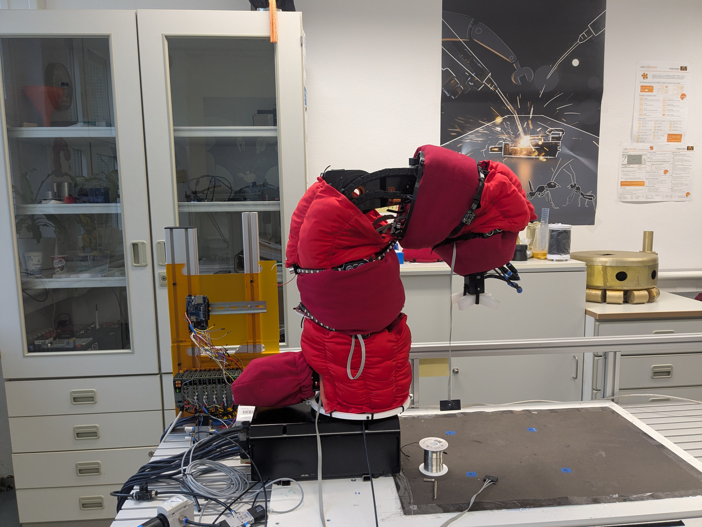 | 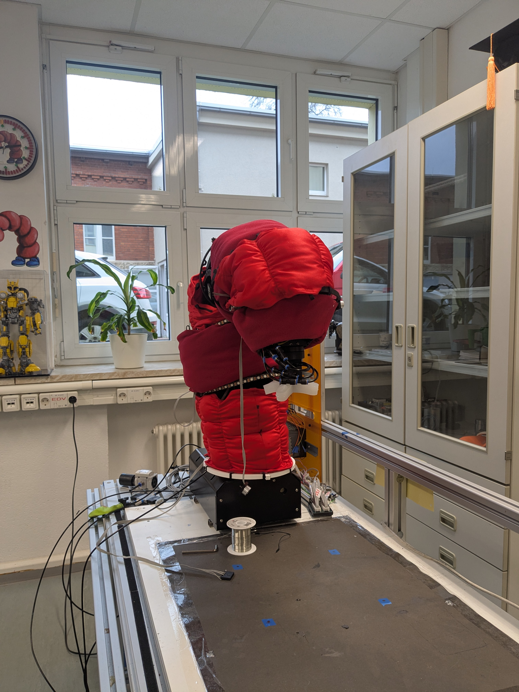 | 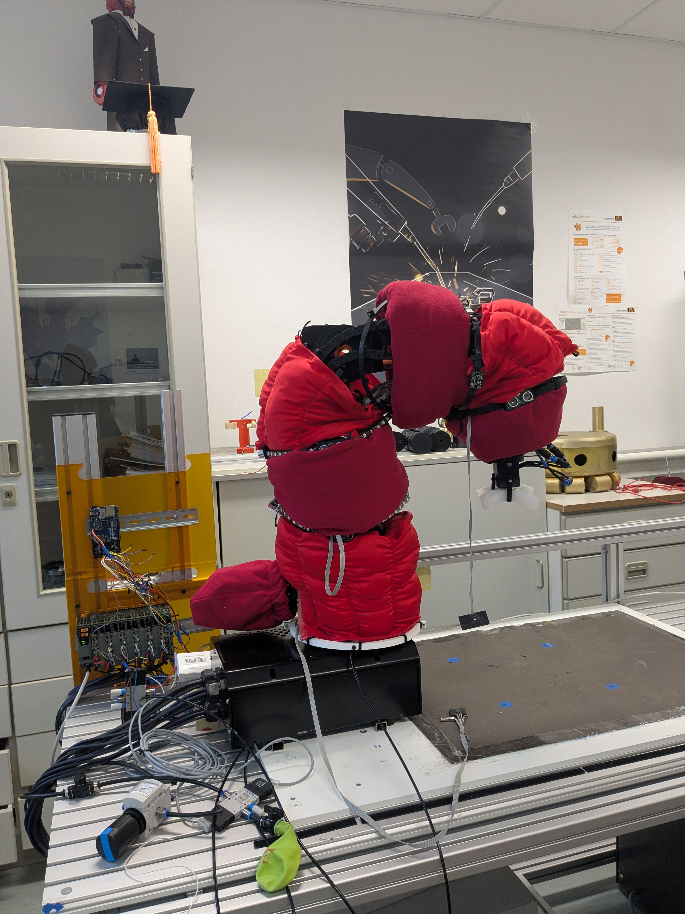 | 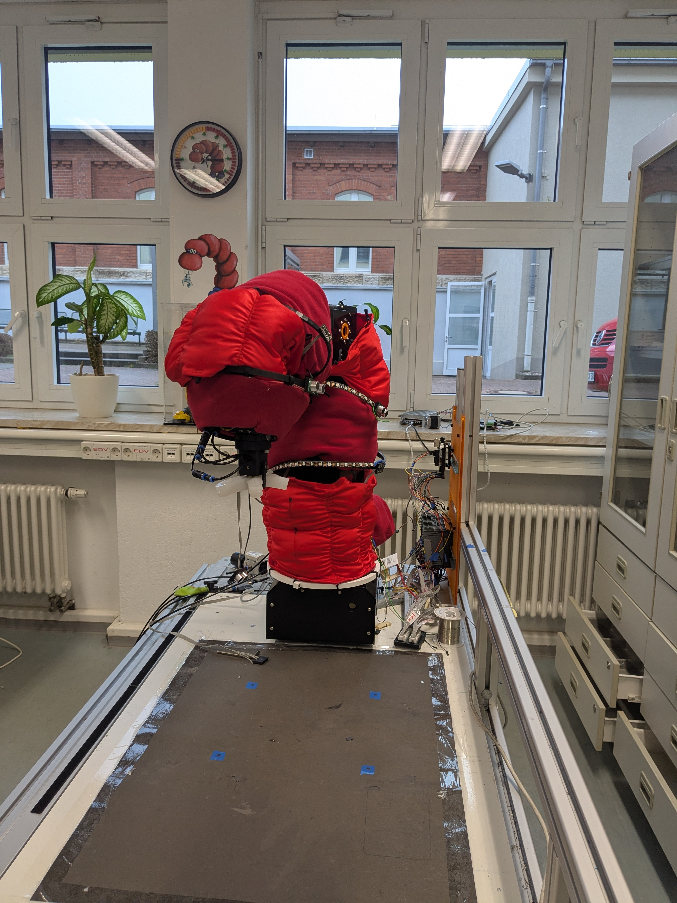 |
| Side view | From the left | Elbow and wrist folded | From the front |

## Demos

| Gesture Jog in front of the robot | Jog screen recording |
|---|---|
| [▶ gerster-jog-demo-2.mov](docs/screenshots/gerster-jog-demo-2.mov) (10 s) | [▶ jog-screen-video.mp4](docs/screenshots/jog-screen-video.mp4) (24 s) |
| The operator holds arm poses in front of the phone and the arm follows | The Jog screen recorded on the phone while driving the arm |

The [project site](https://nazmos-sakib.github.io/Jog-the-Robot/#demos) plays these videos inline.

## Bluetooth protocol

The ESP32 runs a BLE GATT server with the **Nordic UART Service**. UUIDs are defined in both `BleUuids` (app) and `JogReceiver.ino` and must match.

| Role | UUID | Properties |
|---|---|---|
| Service | `6E400001-B5A3-F393-E0A9-E50E24DCCA9E` | |
| RX (phone → ESP32) | `6E400002-B5A3-F393-E0A9-E50E24DCCA9E` | Write, Write without response |
| TX (ESP32 → phone) | `6E400003-B5A3-F393-E0A9-E50E24DCCA9E` | Notify (CCCD `0x2902`) |

The ESP32 advertises as **`JogTheRobot`**. All messages are ASCII text lines ending in `\n`. Both sides buffer bytes until a newline, because BLE packets can split or join lines.

### Phone → ESP32

| Command | Meaning | When it is sent |
|---|---|---|
| `A1:L` … `A5:L` | Jog axis 1–5 in the negative direction | Every 100 ms while held |
| `A1:R` … `A5:R` | Jog axis 1–5 in the positive direction | Every 100 ms while held |
| `S` | Stop jogging | On release |
| `P1` | Robot power on | Once per tap |
| `P0` | Robot power off | Once per tap |
| `H` | Home the robot | Once per tap |
| `X` | Stop a running program, move or homing | Once per tap |

### ESP32 → phone

| Line | Meaning |
|---|---|
| `ST:<state>,<plc>` | Robot state code (table above) and PLC online flag `0`/`1`. Sent once a second and immediately on any change. Example: `ST:20,1`. |
| `OK A2:R`, `OK S` | Acknowledges a new jog direction or a stop. Repeats of the same jog are not acknowledged. |

## ESP32 ↔ PLC (Modbus TCP)

The ESP32-S3-ETH (W5500 Ethernet) is a Modbus TCP **server** at `194.94.86.15:502`. The PLC is the client.

Input registers the PLC reads (function code 4):

| Reg | Name | Value |
|---|---|---|
| IR0 | heartbeat | +1 every 100 ms while `loop()` runs |
| IR1 | enable | 1 = phone connected over BLE |
| IR2 | axis | 0 = none, 1–5 |
| IR3 | direction | 0 = stop, 1 = positive (R), 2 = negative (L) |
| IR4 | command | 1 = power on, 2 = power off, 3 = home, 4 = stop |
| IR5 | cmd seq | +1 per new command. The PLC acts once per new number. |

Holding registers the PLC writes (function code 16):

| Reg | Name | Value |
|---|---|---|
| HR0 | state | PLC state machine code |
| HR1 | hb echo | Copy of IR0. While it keeps changing, the PLC counts as online (1 s timeout). |

## Safety behaviour

- **Deadman on the ESP32**: each jog command is valid for 300 ms. If no new one arrives, the jog stops. Disconnecting the phone stops the jog and clears `enable`.
- **Heartbeat to the PLC**: IR0 lets the PLC's watchdog detect a stalled ESP32.
- **App side**: jog buttons are disabled unless the PLC is online and the state allows jogging. In Gesture Jog, every exit from the jog loop sends `S`.
- Commands received after the phone disconnected are dropped.

## Build and setup

### Android app

- Android Studio with AGP 9.1, Kotlin 2.2, JDK 17 or newer.
- `minSdk 24`, `targetSdk 36`.
- Main libraries: Jetpack Compose + Material 3, Navigation Compose, Hilt, CameraX 1.3.2, ONNX Runtime Android 1.18.0.
- The device needs Bluetooth LE and a front camera. NNAPI acceleration depends on the phone's drivers.

```bash
./gradlew :app:installDebug
```

Then open the app, tap **Connect to a device**, pick `JogTheRobot` from Nearby devices (it is saved after the first connection), and open **Jog** or **Gesture Jog** from the drawer.

### ESP32 firmware

1. Board: Waveshare ESP32-S3-ETH. In Arduino IDE select **ESP32S3 Dev Module** with the **esp32 by Espressif 3.x** core (3.x is needed for the W5500 `ETH` driver).
2. Install **modbus-esp8266** by Alexander Emelianov from the Library Manager.
3. Set **Tools > USB CDC On Boot > Enabled** to see logs on the USB-C port at 115200 baud.
4. Check the W5500 pins and the network settings (`LOCAL_IP`, `GATEWAY`, `SUBNET`) at the top of `JogReceiver.ino` against your board and PLC subnet, then upload `esp32/JogReceiver/JogReceiver.ino`.
5. The serial monitor prints an `[ALIVE]` line every 3 s with BLE, Ethernet link and PLC status.

### PLC

The B&R side (`plc-for-usb/`) polls the ESP32's input registers, writes its state and the heartbeat echo back, and maps axis/direction/command to the robot's jog and state machine. See `RemoteJog.st`, `Main.st` and `IoMap_lines.txt`.
